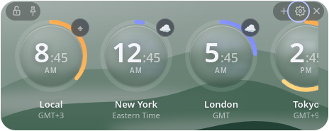
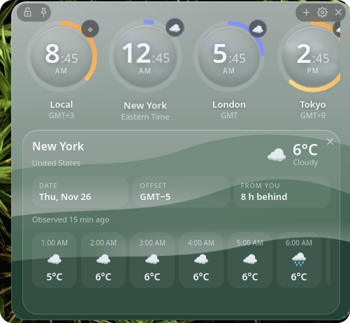
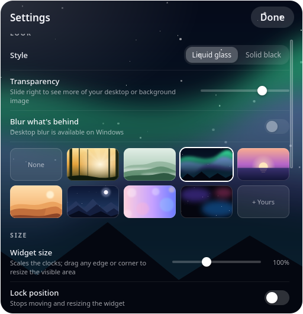

# ORBIT

A compact world clock for your desktop. ORBIT shows the time in your chosen cities as rings that move through the day, with optional weather and forecasts.



*ORBIT running on Fedora KDE.*

## Install on Fedora

ORBIT 0.1.0 is available as an RPM for **Fedora 44 on x86_64**. Download `ORBIT-0.1.0-1.x86_64.rpm` from the [GitHub releases page](https://github.com/Sami7ma/ORBIT/releases) when the release is published. Then open a terminal in your Downloads folder and run:

```sh
cd ~/Downloads
sudo dnf install ./ORBIT-0.1.0-1.x86_64.rpm
```

Open **ORBIT** from the application launcher, or run `orbit` in a terminal. To remove the application, run `sudo dnf remove ORBIT`.

This package is unsigned. The Fedora 44 KDE installation and basic app use have been reported working; other Fedora versions and upgrade/removal paths still need testing. See [verification](docs/testing.md) for the test record.

## Using ORBIT

- **Add and arrange cities:** Use the plus button and search for a city or timezone. Reorder your cities in the picker.
- **View details:** Click the center of a clock to see its date, time difference and forecast. Press Escape or move away to close it.
- **Resize and scroll:** Drag an edge or corner to change the visible area. Scroll to reach cities outside the window.
- **Lock and pin:** Use the controls in the top-left corner to lock the window in place or keep it above other windows.
- **Customize:** Open Settings to change the appearance, clock size, time format and weather units. Weather can be turned off. For Local weather, select a location in Settings or the clock details.

| Forecast | Appearance settings |
| --- | --- |
|  |  |

These screenshots were captured from the Fedora application. More examples and their provenance are in [verification](docs/testing.md#screenshot-provenance).

## Availability

| Platform | Status |
| --- | --- |
| Fedora 44 KDE, x86_64 | RPM built; installation and basic use reported working |
| Windows | Installer built in CI; native installation and desktop behavior still need testing |
| Plasma widget | Planned |
| Android and iOS | Planned |

The detailed platform roadmap is in [progress](docs/progress.md).

## Develop and verify

ORBIT is built with Tauri, Rust, React and TypeScript. For the browser preview and frontend checks, use Node 22.13 or later:

```sh
npm ci
npm run dev
npm test
npm run build
```

For native prerequisites, packaging, browser tests and platform checks, see [development](docs/development.md) and [verification](docs/testing.md). The clock and bundled city search work offline; optional weather and worldwide city search use [Open-Meteo](https://open-meteo.com/).
