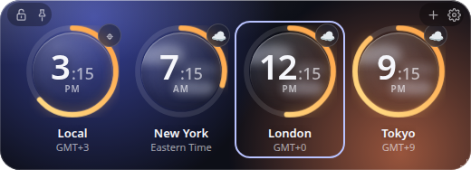
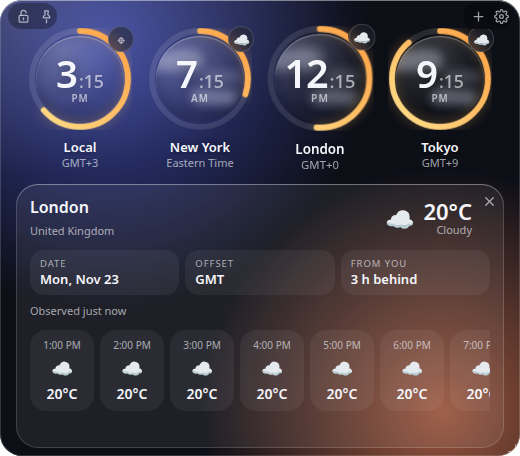
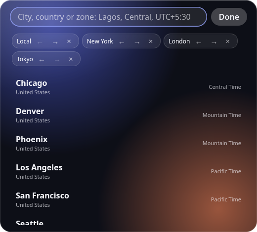

# ORBIT

A glass world-clock widget built with Tauri 2, Rust, React and TypeScript. Each ring shows progress through a city's local day, with optional weather scenes inside and an expandable forecast below.



The images in this README are current **browser development previews**, captured with a fixed sample clock and mocked weather. They are not native Windows/Fedora screenshots. See [screenshot provenance and verification](docs/testing.md).

## Status

| Surface | Status |
| --- | --- |
| Browser preview | Shared interface, clock, city management and weather states implemented; automated browser checks |
| Windows desktop | Native compilation and NSIS generation passed in CI; installer and desktop behavior checks remain |
| Fedora desktop | Fedora 44 RPM built with locked dependencies; installation and KDE Wayland interaction checks remain |
| Plasma 6 widget | Planned native QML surface |
| Android / iOS | Planned mobile adaptation and native home-screen widget integrations |

Implementation details and remaining platform gates are tracked in [progress](docs/progress.md).

## Develop and verify

Use Node **22.13+**. Rust and platform build dependencies are required for native Tauri runs; they are not required for the browser preview or frontend tests.

```sh
npm ci
npm run dev
npm test
npm run build
```

Open the URL printed by Vite for the browser preview.

To check the interface in Chromium:

```sh
npx playwright install chromium
npm run test:e2e
npm run screenshots
```

See [testing](docs/testing.md) for the scope of those checks and the native manual test matrix.

## Windows

Install Rust, the Microsoft C++ Build Tools with the Desktop development with C++ workload, and the WebView2 prerequisites described by [Tauri](https://v2.tauri.app/start/prerequisites/).

```sh
npm run tauri -- dev
npm run tauri -- build
```

The Windows override targets NSIS. The release executable is under `src-tauri/target/release/`, with the installer under its `bundle/nsis/` directory.

The Windows window has no taskbar button. Its tray menu provides **Show ORBIT** and **Quit ORBIT**. Desktop stacking is an application-window behavior: verify Win+D and tray recovery on your setup. Compilation and NSIS generation pass in CI; the reveal/restoration path still needs native Windows interaction checks.

## Fedora KDE

Install Rust and the Fedora build dependencies described by [Tauri](https://v2.tauri.app/start/prerequisites/). For a conventional Fedora installation, the dependency list includes:

```sh
sudo dnf install rust cargo webkit2gtk4.1-devel openssl-devel curl wget file \
  libappindicator-gtk3-devel librsvg2-devel libxdo-devel gcc gcc-c++ make patchelf
```

Then use `npm run tauri -- dev` for development, or build the RPM with the retained Rust lockfile:

```sh
npm run tauri -- build -- --locked
```

The Linux override targets RPM. A Fedora 44 x86_64 package has been built and inspected; installation and KDE Wayland interaction checks remain. For a local build, install and launch it with:

```sh
sudo dnf install ./src-tauri/target/release/bundle/rpm/ORBIT-0.1.0-1.x86_64.rpm
orbit
```

See the [native verification record](docs/testing.md#native-verification-record) for measured results and remaining checks.

Linux starts as a taskbar-visible window and does not receive Windows-only desktop stacking requests. The desktop-blur setting is disabled outside Windows. A native Plasma widget is a later, separate implementation.

## Use ORBIT

- Click or tap the center of a clock for details, or focus it and press Enter/Space. Hovering and scrolling keep the widget compact. Escape, the close button, leaving the widget or switching away closes details.
- The top-left **lock** toggles movement and resizing; the **pin** keeps ORBIT above other windows. Both preferences persist across launches. Active controls stay visible.
- Reveal the other controls by hover or keyboard focus. Use **Add a city** or **Settings**.
- Add cities with offline search, timezone names, UTC or worldwide search. Unaccented search such as `Montreal` matches `Montréal`.
- Use the arrow buttons in the city picker to reorder selected clocks. At least one clock remains selected.
- Drag any edge or corner to resize the visible city area, down to one complete clock. Taller areas add rows; scroll horizontally to reach the remaining cities. Resize handles also respond to arrow keys.
- Drag the widget background to move it. **Widget size** in Settings changes clock scale independently. **Lock position** disables both moving and resizing.
- Choose glass or solid black, background scenes or a custom image, scale, 12/24-hour time, AM/PM and UTC/GMT labels.
- Weather badges stay visible while enabled, including loading, unavailable and saved-data indicators. Fresh weather animates inside the rings; turn **Show weather** off to hide badges, scenes and forecasts.
- Choose Celsius or Fahrenheit. Missing temperatures display an em dash, and retained forecasts show their age and refresh status.
- **Local** follows the device timezone. Select its weather location explicitly in Settings or its details panel. Timezones alone do not identify a weather location.

## Interface previews

| Forecast | City management |
| --- | --- |
|  |  |

Browser previews use sample weather and a fixed clock; native desktop verification is tracked separately.

More browser references: [appearance settings](docs/screenshots/browser-settings.png), [weather settings](docs/screenshots/browser-weather-settings.png), [city management](docs/screenshots/browser-cities.png), [solid appearance](docs/screenshots/browser-solid.png), [one-city viewport](docs/screenshots/browser-single-city.png), and [two-row viewport](docs/screenshots/browser-two-rows.png).

## Saved data and offline use

The clock and bundled search work offline. Weather is optional and cached in memory; a new offline launch has no saved forecast. Network failures keep the last successful forecast for the running session, label it as saved, keep a marked weather badge, and suppress stale animated scenes.

Existing city lists migrate to version 3. Valid cities are retained, damaged entries are repaired, and original data is backed up before replacement. Legacy inferred Local weather coordinates require a new explicit selection. Unknown future schemas remain untouched and use temporary session defaults.

The recovery screen resets only ORBIT's storage keys. Custom images are resized locally and are not uploaded. See [architecture and data flow](docs/architecture.md).

## Data attribution

Weather and worldwide city search are provided by [Open-Meteo](https://open-meteo.com/). Weather values are rounded for display and temperatures use the selected unit. Data is attributed under [CC BY 4.0](https://creativecommons.org/licenses/by/4.0/); review the provider's [terms](https://open-meteo.com/en/terms) for your distribution model.

Autostart, single-instance handling, monitor recovery, native Plasma/Android/iOS widgets and release signing remain on the [implementation roadmap](docs/progress.md).
